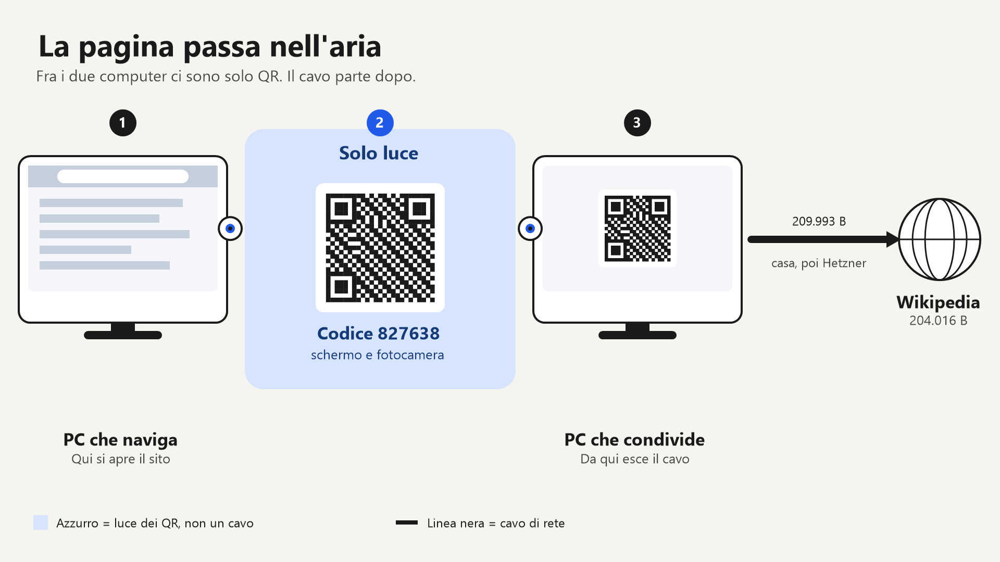
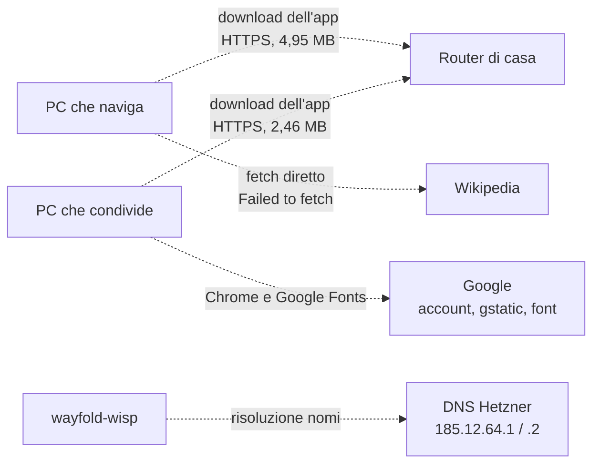
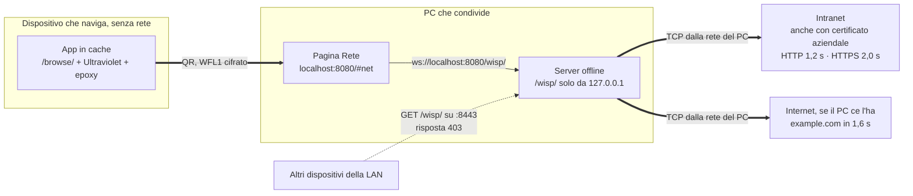
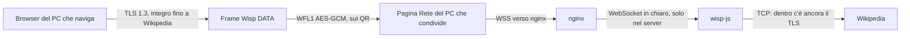
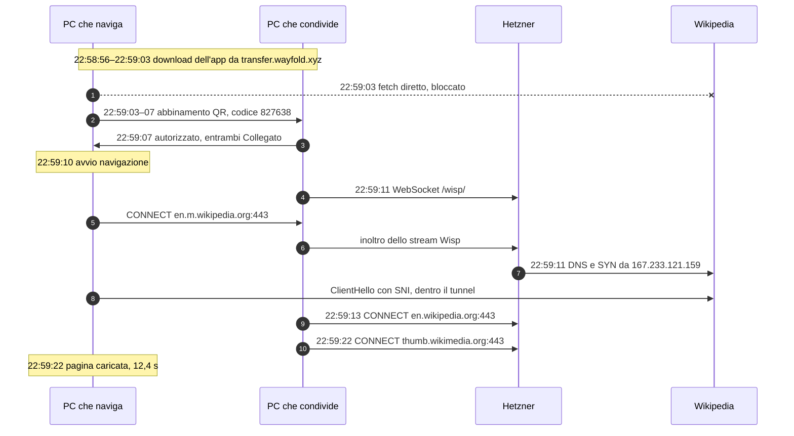

# WayFold Rete: grafico dei collegamenti

Cattura del 21/11/2026, 22:58:55–22:59:24 UTC. Navigazione di prova: `https://en.m.wikipedia.org/wiki/QR_code` dal PC che naviga, tramite il collegamento ottico verso il PC che condivide. Dettagli e prove in [report.md](report.md).

Nel disegno l'azzurro è la luce fra i due schermi. La linea nera è il cavo, e parte solo dal PC che condivide. La stessa slide è in [collegamento-luce.pptx](collegamento-luce.pptx).

## Percorso dei dati

Tra i due PC non c'è un pacchetto di rete: i frame WFL1 passano solo dai QR. Il TLS verso Wikipedia resta cifrato fino al PC che naviga; nginx e il container vedono l'host di destinazione e il volume, non la pagina.

## Traffico che non è la pagina

Il fetch diretto dal PC che naviga verso Wikipedia non è uscito: il browser lo ha chiuso prima di un pacchetto utile. La pagina è passata solo dal tratto spesso del grafico precedente.

## Modalità rete chiusa

Pacchetto offline, test del 21/11/2026 23:27 UTC. Il PC che condivide avvia `Avvia-Relay.bat` e apre `http://localhost:8080/#net`. L'uscita Wisp è sul PC stesso, quindi chi naviga raggiunge ciò che quel PC raggiunge. Nel test il dispositivo che naviga non aveva rete propria.

## Strati di cifratura

## Sequenza

Orari in UTC. Partecipanti da sinistra a destra, nell'ordine in cui i byte si muovono.

